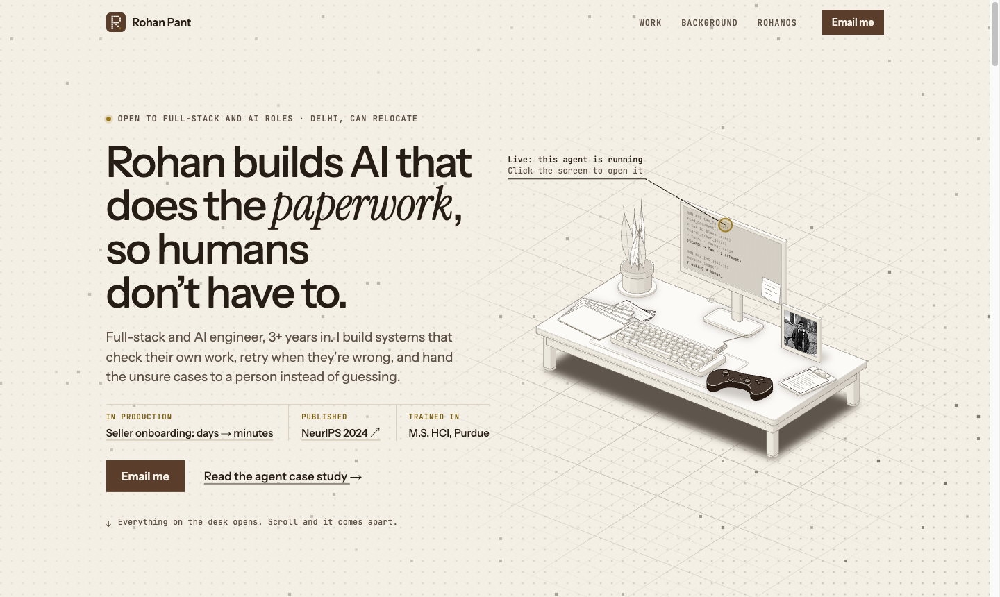
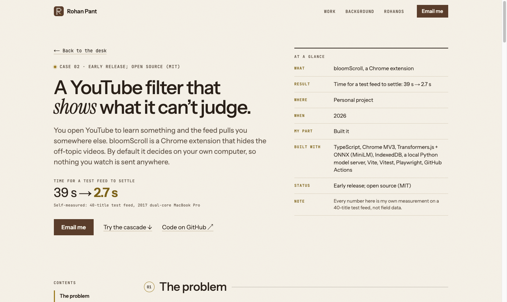

# rohan2010.github.io

The portfolio of **Rohan Pant**, a full-stack and AI engineer in Delhi.
Live at **[rohan2010.github.io](https://rohan2010.github.io)**.



## What's on the site

- **A desk you can take apart.** The hero is an isometric desk drawn in code. Every object opens
  something: the photo is an intro, the keyboard lists skills, the boarding passes are the career
  so far. Scroll and the desk comes apart piece by piece.
- **rohanOS.** Click the monitor and you sit down at a small retro desktop. Each project is a
  folder with its README, a system diagram and, where there is one, a live demo.
- **Case studies.** One page per project at `/work/<project>/`: the problem, how it's built, the
  decisions worth explaining, how it was tested, and before and after.
  - [Seller onboarding agent](https://rohan2010.github.io/work/onboarding-agent/): a LangGraph
    agent that took seller activation from days to minutes.
  - [bloomScroll](https://rohan2010.github.io/work/bloomscroll/): a Chrome extension that keeps
    YouTube on topic, decided on your own computer.
  - [Value Imprint](https://rohan2010.github.io/work/value-imprint/): a NeurIPS 2024 paper
    auditing the human values inside RLHF datasets.
  - [DecentralMem](https://rohan2010.github.io/work/decentralmem/): project memory for AI
    assistants, served over MCP.
- **Two demos you can play.** A toy version of the onboarding agent (drag a document in and watch
  it check, fail and retry) and bloomScroll's filtering cascade on a made-up feed.
- **A hero that reacts to the cursor.** A dither grid on a canvas: faint dots that twinkle at rest
  and warm to brass where the pointer passes.



## How it's built

- **Next.js 16 + React 19**, exported as a fully static site (`output: "export"`) and deployed to
  **GitHub Pages** by a GitHub Actions workflow on every push to `main`.
- **TypeScript** and hand-written CSS on design tokens (the Tobacco & Brass palette), no
  component library.
- **The desk** is generated as SVG by `figures/desk/build.mjs` before every dev run and build,
  then made interactive in React.
- **Fonts:** Instrument Sans, Instrument Serif and JetBrains Mono, plus B612 and Pixelify Sans
  inside rohanOS. All are under the SIL Open Font License and self-hosted through `next/font`.
- **Content** lives in `src/content/projects/<slug>/`: `project.json` for the facts and the system
  diagram, `case.md` for the case study, `README.md` for rohanOS. Pages are generated from it at
  build time, so adding a folder adds a project.

## Run it locally

```bash
npm install
npm run dev     # http://localhost:3000
npm run build   # static site in out/
```

Needs Node 22 (the version the deploy uses).

## Project layout

```
src/
  app/            routes: the home page and /work/[slug] case studies
  brand/          nav, logo mark, shared section pieces
  case/           case-study components (facts, contents rail, before and after)
  content/        projects and site facts
  desk/           the interactive isometric desk
  home/           hero dot grid and the take-apart scroll
  os/             rohanOS, the retro desktop
  theme/          the colour tokens
  demos/, toy/    the playable demos
figures/desk/     the script that draws the desk
```

## Contact

Open to full-stack and AI engineering roles. Email
[rohanpant.work@gmail.com](mailto:rohanpant.work@gmail.com), or find me on
[LinkedIn](https://www.linkedin.com/in/rohan-pant/).

The code is here to read and learn from. The writing, photos and case-study content are mine;
please don't reuse them as your own.
