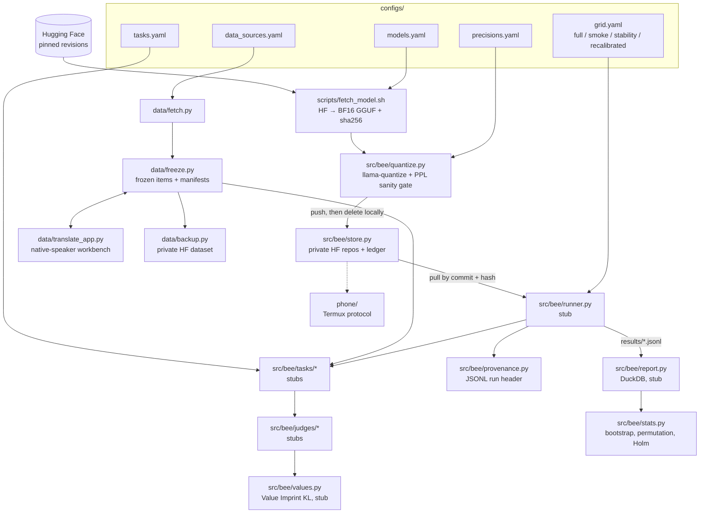

# BharatEdge-Eval (`bharat-edge`): case-study dossier

> Source: `github.com/rohan2010/bharat-edge` (public), read at HEAD `08f3d2b`. **Status guard: independent research, paper in preparation, NOT published, and no results exist in the repo** (results, write-up and research notes are gitignored until publication, per commit `08f3d2b`). The page must present this as a protocol and harness in progress. Never imply findings, and never state the hypotheses as results.

## 1. Hook

**Hook:** Does shrinking a small language model to fit a budget phone hurt Hindi and Hinglish speakers more than English speakers, and can a free calibration fix win it back?

- **Problem:** To fit a 4 GB phone, models are quantized to 4 bits or fewer, usually calibrated on English text and checked with English metrics. The README says no study has measured Indic and code-mixed (Hinglish) quality *and* safety loss together on sub-2B models.
- **For:** researchers and practitioners deploying on-device LLMs in India, and anyone choosing a GGUF build for non-English users.

## 2. Architecture

A reproducible evaluation harness. llama.cpp + GGUF only, on an Apple-silicon Mac (Metal), plus a planned Android feasibility run.

### Node list

| id | label | kind | file(s) | state |
|---|---|---|---|---|
| `configs` | Experiment configs (models, precisions, tasks, grids) | config | `configs/*.yaml` | done |
| `hf` | Hugging Face sources (pinned revisions) | external | — | — |
| `fetch_model` | Fetch + convert to BF16 GGUF | script | `scripts/fetch_model.sh`, `scripts/build_llamacpp.sh` | done |
| `quantize` | Quantize + perplexity sanity gate | core | `src/bee/quantize.py` | done |
| `store` | Private HF model store + ledger | storage | `src/bee/store.py` | done |
| `data_fetch` | Download pinned task data | script | `data/fetch.py` | done |
| `freeze` | Freeze item sets + manifests + script checks | core | `data/freeze.py` | done |
| `translate_app` | Local translation workbench | tool/ui | `data/translate_app.py`, `translate_app.html` | done |
| `backup` | Backup of gitignored research files | tooling | `data/backup.py` | done |
| `runner` | Grid cell runner | core | `src/bee/runner.py` | stub |
| `tasks` | Belebele, generation, safety, over-refusal, probe | core | `src/bee/tasks/*.py` | stubs |
| `judges` | IndicGuard, local judge, API judge, agreement | core | `src/bee/judges/*.py` | stubs |
| `provenance` | Run header (llama.cpp commit, GGUF sha256, config hash, seed) | core | `src/bee/provenance.py` | done |
| `stats` | Relative loss, gap, bootstrap CI, permutation, Holm | analysis | `src/bee/stats.py` | done |
| `report` | DuckDB tables + plots | analysis | `src/bee/report.py` | stub |
| `values` | Value Imprint value-drift KL | analysis | `src/bee/values.py` | stub |
| `phone` | 4 GB Android feasibility protocol | protocol | `phone/README.md` | planned |

### Edge list

| from | to | label |
|---|---|---|
| `hf` | `fetch_model` | weights at pinned revision |
| `fetch_model` | `quantize` | BF16 GGUF + `SOURCE.txt` + sha256 |
| `quantize` | `store` | push one build, verify hash, delete local |
| `data_fetch` | `freeze` | raw data (sha256 per source) |
| `freeze` | `translate_app` | worksheets (edited in place, atomic writes) |
| `translate_app` | `freeze` | completed translations → freeze when column complete |
| `freeze` | `backup` | frozen items, manifests, ledger → private HF dataset |
| `store` | `runner` | pull build by HF commit + sha256 |
| `configs` | `runner` | grid → run specs |
| `runner` | `tasks` | one (model, precision, task, language) cell |
| `tasks` | `judges` | outputs for judged tasks |
| `runner` | `provenance` | first JSONL line |
| `runner` | `report` | `results/<run_id>.jsonl` |
| `report` | `stats` | per-cell scores → Δ, G, CIs |
| `judges` | `values` | answers → value-category distribution |

**Boundaries:** public code vs. private research artefacts (results, write-up, ledger and manifests are gitignored until publication, then backed up to private HF repos); local Mac disk vs. off-machine model store; harmful outputs stay in `results/` and are never printed or committed (`CLAUDE.md` rule 4).

## 3. Key decisions and trade-offs

| Decision | Trade-off | Evidence |
|---|---|---|
| **Pre-registered gates that can stop the project** (Gate 1: amplification > 1.5 or stop; Gate 2: judge-human agreement ≥ 80% or judged results are exploratory; Gate 3: otherwise publish a negative result) | Commits up front to reporting null or negative outcomes | `README.md` "Gates"; `src/bee/judges/agreement.py` (`GATE2_THRESHOLD = 0.80`) |
| **Every build quantized straight from BF16**, never from another quantized build | Each precision carries only its own error. Verified byte-identical across thread counts, so any build can be re-made and checked by hash | `src/bee/quantize.py` docstring |
| **One build at a time:** quantize → sanity → push → delete, resumable from the ledger | Slower, but fits about 20 GB of free disk | `src/bee/quantize.py`, `src/bee/store.py`, `CLAUDE.md` |
| **Perplexity sanity gate (max 3× BF16 per language) is explicitly not a result** | Catches broken builds (PPL in the thousands or NaN) without peeking at outcomes | `quantize.py` `MAX_PPL_RATIO = 3.0` comment |
| **Amplification ratio reported only when English loss > 1 point** | Avoids an unstable ratio near zero; G (the difference) is always reported | `src/bee/stats.py` docstring, `CLAUDE.md` |
| **Greedy decoding everywhere, plus a separate 3-seed stability grid** | Differences come from quantization alone; sampling sensitivity is checked separately | `configs/grid.yaml` |
| **Comprehension probe on every safety item** | Separates "didn't understand" from "refused" or "complied", so safety loss isn't confounded with comprehension loss | `src/bee/tasks/probe.py` |
| **A short "Don't" list for the stack:** no MLX, vLLM, AWQ/GPTQ, LangChain or fine-tuning; no models ≥3B; no paid frontier judge as the main judge | Narrow scope and one quantization format, so results are comparable | `CLAUDE.md` "Stack" |
| **Python must be uv-managed 3.11.14** | python.org builds use the macOS 12.1 SDK, so Metal disables BF16 kernels and BF16 models crash | `README.md` "Note on Python"; `pyproject.toml` |
| **Scope cut: held-out Bengali/Tamil dropped** (2026-10-16) | Smaller language set | `configs/tasks.yaml` comment, commit `08f3d2b` |
| **Unpublished research kept out of git** | The public repo shows the method, not the data or results | commit `08f3d2b` |

## 4. Interesting engineering details

1. **Content-addressed provenance end to end.** Every run's JSONL header records the llama.cpp commit (both the pinned checkout and the copy vendored in llama-cpp-python, which may differ), the GGUF sha256, the config hash and the seed. Community Q4 builds are pinned by repo commit *and* sha256. *Evidence: `src/bee/provenance.py`, `configs/models.yaml`.*
2. **A hash-verified off-machine model store.** One private HF repo per model, plus a ledger mapping each file to its repo, HF commit and SHA-256. A push refuses files whose hash changed since build, and a pull always returns exactly the bytes that were pushed. *Evidence: `src/bee/store.py`, commit `08f3d2b`.*
3. **Script-aware translation checks.** Hindi must be mostly Devanagari and Hinglish must be Latin only. Devanagari is counted per *word*, not per letter, because Python's `unicodedata` doesn't treat Devanagari vowel signs as letters. *Evidence: `data/freeze.py` (`script_share`, `devanagari_word_share`, `check_translation`).*
4. **Freezing as a contract.** Re-freezing must reproduce the same file hash, or the task's `version` must be bumped first. Belebele rows are re-aligned by key because upstream language files aren't in the same row order. *Evidence: `data/freeze.py` docstring and `belebele()`.*
5. **A local, offline translation workbench** for native speakers. It edits the CSV worksheets in place with atomic writes, snapshots each worksheet to `.history/` on start, and listens only on 127.0.0.1. *Evidence: `data/translate_app.py`.*

## 5. What I learned (drafts)

- *DRAFT – confirm with Rohan:* "I wrote down the conditions under which I'd stop or publish a negative result before running anything. It makes the project honest about what it can and can't claim." (README "Gates")
- *DRAFT – confirm with Rohan:* "Reproducibility is mostly bookkeeping: hashes, pinned commits and frozen item sets. Building that before the first experiment is cheaper than reconstructing it later." (`provenance.py`, `freeze.py`, `store.py`)
- *DRAFT – confirm with Rohan:* "Toolchain details can silently change results. A python.org Python build quietly disabled BF16 kernels on Metal." (README "Note on Python")
- *DRAFT – confirm with Rohan:* "This connects to Value Imprint. I want to know whether compression shifts the values a model expresses, not only its accuracy." (README H3, `src/bee/values.py`)

## 6. Status, timeline, stack, links

- **Status:** independent research; **paper in preparation, not published.** Milestone 1 (setup) is done per README. Commit `08f3d2b` lands Milestone 2 code (quantized builds, data freeze, translation workbench), but the README status table still says "Milestone 2: Not started" (stale, see open questions). Runner, tasks, judges, report and values modules are `NotImplementedError` stubs. **No results are public.**
- **Timeline:** repo created 2026-10-15. First commit `c4fe4dd` on 2026-10-15 23:29 +0530; last commit `08f3d2b` on 2026-10-16 12:51 +0530 (2 commits; the second is co-authored with Claude per its trailer).
- **Stack:** Python 3.11.14 (uv), llama.cpp (`llama-quantize`, `llama-imatrix`, `llama-perplexity`) at a pinned commit, llama-cpp-python (Metal), GGUF, huggingface_hub, YAML configs, JSONL, DuckDB, NumPy/SciPy/pandas/Matplotlib, pytest + ruff (38 tests across 6 files). Planned: IndicGuard, a local 8–12B judge, PyTorch MPS for the Value Imprint classifier, and Termux on Android.
- **Models under study:** Gemma 3 1B IT, Qwen3 1.7B, Llama 3.2 1B Instruct, Qwen3 0.6B. 24 configurations plus 8 recalibrated builds.
- **Links:** repo https://github.com/rohan2010/bharat-edge. No paper, no demo. `docs/` referenced by the README is not in the public tree (gitignored).

## 7. Visual idea

**The experiment grid as an interactive matrix, with results deliberately empty.** Rows are 4 models × 6 builds (BF16 → Q3_K_M + community Q4); columns are 3 languages × 5 tasks. Cells show "pending" states and the milestone and gate each depends on. Hovering a cell shows its provenance tuple (llama.cpp commit, GGUF sha256, seed). A thin "gate rail" above shows Gate 1 → 2 → 3 with stop conditions. This shows the rigour without showing numbers, and the cells fill in when the paper is out.

## 8. Open questions for Rohan

1. How should the page describe status: "paper in preparation", "under review" or "preprint planned"? Any target venue to *not* mention?
2. Can the hypotheses (H1–H4) be shown publicly? They're in the public README, but placing them on a portfolio page might read as claims.
3. The README status table says Milestone 2 is "Not started" while commit `08f3d2b` lands it. Which is true today, and should the README be updated?
4. Is anyone else involved (co-authors, native-speaker translators, advisor)? The page should credit them.
5. Is the H3 link to Value Imprint (reusing that classifier) something you want highlighted as a research through-line?
6. Is there a phone yet for the Milestone 8 feasibility run, and which model?
