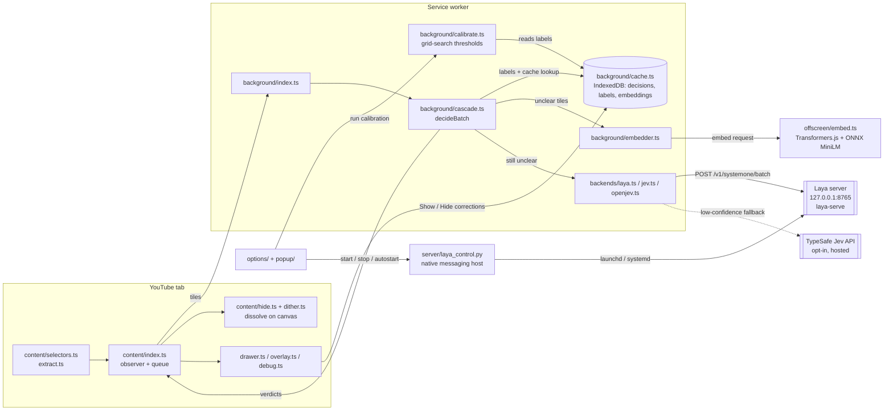

# bloomScroll: case-study dossier

> Source: `github.com/rohan2010/bloomScroll` (public, MIT), read at HEAD `76acf42`. All paths below are relative to that repo. Every number quoted here comes from the repo's own README, `server/README.md` or commit messages, so treat each as a self-measurement on a 40-title fixture feed, not as a field result.

## 1. Hook

**Hook:** A browser extension that keeps YouTube on what you came for. It hides off-topic videos with a cascade of on-device rules, embeddings and a local model, so nothing you watch leaves your computer.

- **Problem:** You open YouTube to learn something and the feed pulls you into rabbit holes. Hosted "focus" filters would mean sending your viewing history to a server.
- **For:** people who use YouTube for learning (default intent: programming and tech) and care about privacy. The README targets non-developers too, with a one-command `setup.sh`.

## 2. Architecture

Chrome MV3 extension (`extension/manifest.json`) plus an optional local Python model server (Laya, via `laya-serve`) on `127.0.0.1:8765`.

### Node list

| id | label | kind | file(s) |
|---|---|---|---|
| `content` | Content script (observer, model queue) | browser-content | `extension/src/content/index.ts` |
| `selectors` | YouTube selectors + tile extraction | browser-content | `extension/src/content/selectors.ts`, `extract.ts` |
| `hide` | Hide + dither dissolve | browser-content/ui | `extension/src/content/hide.ts`, `dither.ts` |
| `drawer` | Hidden drawer, Hide button, debug overlay | browser-content/ui | `extension/src/content/drawer.ts`, `overlay.ts`, `debug.ts`, `feedback.ts` |
| `worker` | Service worker router | browser-background | `extension/src/background/index.ts` |
| `cascade` | Decision cascade `decideBatch` | core-logic | `extension/src/background/cascade.ts` |
| `cache` | IndexedDB store (decisions, labels, embeddings) | storage | `extension/src/background/cache.ts` |
| `embedder` | Embedder client (offscreen lifecycle) | core-logic | `extension/src/background/embedder.ts` |
| `offscreen` | MiniLM in offscreen document (Transformers.js, ONNX/WASM) | model-local | `extension/src/offscreen/embed.ts` |
| `backends` | Model backends (Laya, Jev, open Jev) | adapter | `extension/src/background/backends/*.ts` |
| `laya` | Laya local server | external-local-service | `server/start.sh`, `laya-serve` (PyPI `laya`) |
| `jev` | TypeSafe Jev (opt-in, hosted) | external-remote-service | `backends/jev.ts` |
| `nativehost` | Native messaging helper | os-bridge | `server/laya_control.py`, `server/native-host.sh` |
| `calibrate` | Threshold calibration | core-logic | `extension/src/background/calibrate.ts`, `options/calibration.ts` |
| `settings` | Popup + Settings pages | ui | `extension/src/popup/*`, `extension/src/options/*` |
| `setup` | One-command installer | tooling | `setup.sh` |

### Edge list

| from | to | label |
|---|---|---|
| `selectors` | `content` | video tiles (id, title, channel, isShort) |
| `content` | `worker` | decide request (fast stages first, then model batch) |
| `worker` | `cascade` | `decideBatch(tiles, deps)` |
| `cascade` | `cache` | user labels + cached decisions (parallel lookup) |
| `cascade` | `embedder` | texts still undecided after rules |
| `embedder` | `offscreen` | `embed` message |
| `cascade` | `backends` | tiles still undecided after embeddings |
| `backends` | `laya` | `POST /v1/systemone/batch` (batch of 4) |
| `backends` | `jev` | optional fallback for low-confidence answers |
| `cascade` | `content` | verdicts with stage + reason |
| `content` | `hide` | hide off-topic tiles (dither dissolve) |
| `drawer` | `cache` | Show / Hide corrections (labels) |
| `settings` | `nativehost` | status / start / stop / set-autostart |
| `nativehost` | `laya` | launch or unload via LaunchAgent / systemd |
| `calibrate` | `cache` | reads labels, writes thresholds to settings |
| `setup` | `laya` | installs into `~/Library/Application Support/bloomScroll` |

**Boundaries:** (1) the YouTube page vs. the extension's own shadow-root overlays (the dither canvas never lives inside YouTube's recycled elements, `content/dither.ts` header); (2) content script vs. service worker (message passing, `shared/messages.ts`); (3) service worker vs. offscreen document (WASM can't run in an MV3 worker, `embedder.ts`); (4) the browser vs. the local OS (native messaging, loopback HTTP only); (5) the machine vs. the internet, crossed only by opt-in Jev, which Settings labels with a warning.

## 3. Key decisions and trade-offs

| Decision | Trade-off | Evidence |
|---|---|---|
| **Cheapest-confident-stage cascade:** user labels, then cache, rules, embeddings, model, fail-open | More moving parts, but most tiles never touch the slow model (35 of 40 decided on-device in the fixture) | `extension/src/background/cascade.ts` (header comment and `decideBatch`); README "How it works" |
| **Fail open:** if no model answers, the video is *shown*, and that verdict isn't cached | Some off-topic videos slip through when Laya is down, but the extension never hides something it couldn't judge. Tiles are re-asked once the model is reachable | `cascade.ts` (`uncacheable`, `NO_MODEL_REASON`); `content/index.ts` ("Tiles shown only because no model answered get re-asked later") |
| **Rules are show-only for keywords:** a missing keyword never hides | Lower recall for rules, no false hides from keyword absence | `cascade.ts` `titleMentions` doc comment |
| **Cache key hashes every dependency** (prompt version, topics, thresholds, backend) with FNV-1a | Any settings change invalidates cached decisions automatically | `cascade.ts` `modeIdFor`; `backends/jevWire.ts` `PROMPT_VERSION = 4` |
| **Local model over hosted** (privacy, free, offline) | About 2 GB of disk and up to about 1.5 GB of RAM while working; a Python install | README "Why Laya runs on your computer"; `server/README.md` |
| **Asymmetric cost in calibration:** a wrongly hidden video costs 2× a wrongly shown one; ties go to the thresholds closest to the current ones | Calibration errs toward showing, and doesn't drift without evidence | `extension/src/background/calibrate.ts` (`WRONG_HIDE_COST = 2`, `fit`) |
| **No temperature fitting:** only the single cutoff moves | Simpler; equivalent because laya-serve returns only normalized probabilities | `calibrate.ts` header comment |
| **Rejected ONNX int8 for Laya:** 30% faster but flipped 16 of 40 decisions | Kept slower fp32 | `server/README.md` "Backends" |
| **fp32 instead of fp16 on Apple Silicon MPS** | fp16 was no faster and held about 1 GB more GPU memory; it also made scores depend on batch size | `server/README.md` "Measured on an M4"; commit `76acf42` |
| **Install Laya to Application Support** instead of the repo folder | macOS blocks background agents from reading Desktop/Documents/Downloads | commit `b00d6b1` |

## 4. Interesting engineering details

1. **A speed audit that cut feed-settle time from about 39 s to 2.7 s on a 2017 dual-core MacBook Pro.** It found that Laya re-encodes the whole question per tile, so cost tracks tokens (about 6.5 ms per token). The prompt went from 30 topics plus 8 described categories (980 ms/tile) to a short summary plus 8 labels (394 ms/tile) with no AUC change on the 40-title set. A one-tile warm-up hides macOS paging the idle server out (7.3 s cold vs. 0.47 s warm). *Evidence: `server/README.md`, commit `9895b0d`.*
2. **Ordered-dither dissolve on one full-viewport canvas in a shadow root.** An 8×8 Bayer matrix plus per-cell hash noise plus a top-down sweep, with per-cell thresholds computed once per dissolve into a `Float32Array`. *Evidence: `extension/src/content/dither.ts`, commit `76acf42`.*
3. **Hover by position, not by element.** YouTube's inline preview player covers a hovered thumbnail but lives elsewhere in the DOM, so element-based hover lost the tile. The Hide button tracks the pointer against tile boxes. *Evidence: `extension/src/content/index.ts` around line 418.*
4. **Offscreen document for WASM embeddings, with self-healing.** The worker remembers that the offscreen document exists to skip a `getContexts` round trip. If a message goes unanswered it recreates the document and retries once. Topic and anchor vectors persist in IndexedDB across worker restarts. *Evidence: `extension/src/background/embedder.ts`, commit `76acf42`.*
5. **Native-messaging control plane.** A stdlib-only Python helper lets the Settings page start and stop a launchd/systemd service. It is registered for Chrome, Chromium, Brave and Edge and restricted to the extension's computed unpacked ID. *Evidence: `server/laya_control.py`, commit `3a4b84d`.*
6. (Bonus) **Rendering cost measured, not guessed:** 59 → 37 layouts while loading and about 36 → 6 ms script time per 5 s, with no decision changed on the 40-title eval. *Evidence: commit `76acf42`.*

## 5. What I learned (drafts)

- *DRAFT – confirm with Rohan:* "My first version took about 39 seconds to settle a feed on my old laptop. Measuring showed the cost tracked prompt tokens, not batch size, so shortening the prompt mattered more than any backend change." (`server/README.md`, commit `9895b0d`)
- *DRAFT – confirm with Rohan:* "Faster isn't a win if it changes the answer. int8 quantization saved 30% but flipped 16 of 40 decisions, so I didn't ship it." (`server/README.md`)
- *DRAFT – confirm with Rohan:* "For a filter, the safe failure is to show. Hiding something the user wanted is worse than missing a distraction, so I built that asymmetry into both the cascade and calibration." (`cascade.ts`, `calibrate.ts`)
- *DRAFT – confirm with Rohan:* "Shipping to non-developers is its own engineering problem. Most of the later commits are about installers, macOS privacy rules and start-at-login, not about the model." (commits `d2e0542`, `3a4b84d`, `b00d6b1`, `640bbb4`)

## 6. Status, timeline, stack, links

- **Status:** early release (README "Status"). Works on YouTube home, search and the watch-page sidebar. Built and tested on macOS; Windows and Linux untested. Not on the Chrome Web Store (installed unpacked). "Work" mode is being reworked.
- **Timeline:** repo created 2026-10-17. First commit `b5f16c3` on 2026-10-18 13:04 +0530, last commit `76acf42` on 2026-10-18 23:35 +0530 (9 commits, all on one day).
- **Stack:** TypeScript, Chrome MV3, Vite, Vitest, Playwright (e2e in Chromium), IndexedDB (`idb`), Transformers.js + ONNX Runtime Web (MiniLM all-MiniLM-L6-v2, 23 MB); Python `laya-serve` (PyTorch, MPS on Apple Silicon); bash `setup.sh`, uv; GitHub Actions CI (typecheck, unit, build, Playwright).
- **Links:** repo https://github.com/rohan2010/bloomScroll. No live demo (it's an extension). README media: `docs/assets/how-it-works.gif`, `docs/assets/demo.gif`.

## 7. Visual idea

**An interactive "cascade funnel" over a mock feed.** Show 40 tiles, and let a scrubber or "Play" step through the stages: rules (purple) → embeddings (blue) → Laya (amber) → fail-open (grey), using the debug overlay's colour code. Tiles peel off at the stage that decided them, a running counter reads "35 of 40 decided on device", and off-topic tiles do the real Bayer-dither dissolve. A small side readout shows ms per stage. This is the project's core idea and its signature visual in one piece, and the repo already has a generator for it (`docs/assets/src/how-it-works.html`).

## 8. Open questions for Rohan

1. Can the page reuse `docs/assets/how-it-works.gif` and `demo.gif`, or should we rebuild the explainer as a live web component?
2. Is there any real-world usage yet (yourself, friends), or only the 40-title fixture? The page must not imply field accuracy.
3. Is a Chrome Web Store listing planned soon enough to link?
4. The commits say "Laya" and "Jev" come from ConvAI Innovations / TypeSafe. Do you have any affiliation with them that the page should disclose?
5. Are you comfortable with the "built in one day" framing (all 9 commits on 2026-10-18), or did work happen before the first commit?
