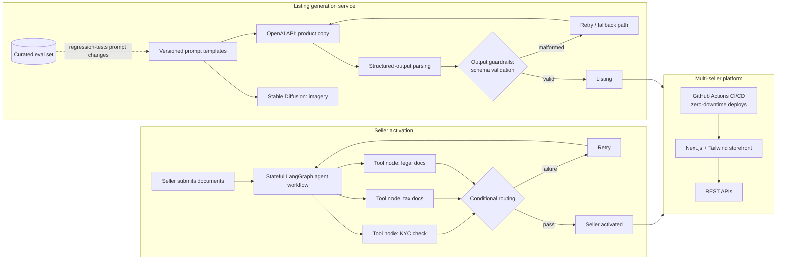

# BulkMagic (professional work): case-study dossier

> **Source: the résumé only** (`docs/RP_resume_developer.pdf`, "BulkMagic, Inc — Software Engineer, Aug 2024 – Present, New York, NY (Remote)"). There is no code, and nothing below goes beyond the résumé's claims. The architecture is a **schematic reconstructed from the bullet wording**, not from the real system. Label it as illustrative on the page, and have Rohan check it against what his employer allows him to disclose.

## 1. Hook

**Hook:** Making AI do dependable production work for a multi-seller commerce platform: agent workflows that onboard sellers, generation that lists products, and the guardrails and evals that keep both reliable.

- **Problem (résumé):** seller activation took days; product listing was slow; generated output had to be reliable in production; storefront launches and deployments were slow.
- **For:** BulkMagic's sellers and internal teams (the résumé doesn't specify further).

## 2. Architecture (illustrative, from résumé wording)

### Node list

| id | label | kind | résumé phrase |
|---|---|---|---|
| `lg_workflow` | Stateful LangGraph agent workflow | agent | "stateful LangGraph agent workflow" |
| `tool_kyc` / `tool_tax` / `tool_legal` | Document-validation tool nodes | tool | "tool-calling nodes validate KYC, tax, and legal documents" |
| `routing` | Conditional routing + retries | control | "conditional routing and retries on failure" |
| `prompts` | Versioned prompt templates | config | "versioned prompt templates" |
| `openai` | OpenAI API (product copy) | external-model | "OpenAI API for product copy" |
| `sd` | Stable Diffusion (imagery) | model | "Stable Diffusion for imagery" |
| `parser` | Structured-output parsing | core | "structured-output parsing" |
| `guardrails` | Output guardrails (schema validation) | safety | "schema validation on model responses" |
| `fallback` | Retry and fallback paths | resilience | "retry and fallback paths for malformed generations" |
| `evalset` | Curated eval set | quality | "regression-tested prompt changes against a curated eval set" |
| `storefront` | Next.js + Tailwind multi-seller platform | frontend | "multi-seller platform (Next.js, Tailwind CSS, REST APIs)" |
| `rest` | REST APIs | backend | same |
| `cicd` | GitHub Actions CI/CD | infra | "automating CI/CD with GitHub Actions" |

### Edge list

| from | to | label |
|---|---|---|
| `lg_workflow` | tool nodes | call validation tools |
| tool nodes | `routing` | result |
| `routing` | `lg_workflow` | retry on failure |
| `prompts` | `openai`, `sd` | render template |
| `openai` | `parser` | raw response |
| `parser` | `guardrails` | structured output |
| `guardrails` | `fallback` | malformed |
| `evalset` | `prompts` | regression test on change |
| `cicd` | `storefront` | deploy (zero downtime) |

## 3. Key decisions and trade-offs (as claimed)

| Decision | Evidence |
|---|---|
| Model seller activation as a **stateful agent graph** with explicit tool nodes and conditional routing, not a single prompt | résumé bullet 1 |
| **Version prompts** and parse **structured outputs** | résumé bullet 2 |
| **Guardrails at the output boundary:** schema validation, retry and fallback | résumé bullet 3 |
| **Regression-test prompt changes** against a curated eval set | résumé bullet 3 |
| **Automate CI/CD** with GitHub Actions for zero-downtime deploys | résumé bullet 4 |

The trade-offs aren't stated in the source; ask Rohan.

## 4. Interesting details (claims to verify)

1. Seller activation "from days to minutes". *Résumé bullet 1.*
2. Product listing time cut 40%. *Résumé bullet 2.*
3. Storefront time-to-market accelerated 30%; deployment cycles halved at zero downtime. *Résumé bullet 4.*
4. Prompt changes gated by a curated eval set. *Résumé bullet 3.*

All four metrics are self-reported; Rohan should confirm they may be published and how they were measured.

## 5. What I learned (drafts)

- *DRAFT – confirm with Rohan:* "In production, the model call is the easy part. The work is the schema checks, retries, fallbacks and eval set around it." (résumé bullet 3; matches the landing page thesis)
- *DRAFT – confirm with Rohan:* anything about the agent workflow's failure modes. The résumé gives no evidence; needs his input.

## 6. Status, timeline, stack, links

- **Status:** current role (Aug 2024 – present).
- **Timeline:** Aug 2024 – present (résumé). No commit history.
- **Stack (résumé):** LangGraph, OpenAI API, Stable Diffusion, Next.js, Tailwind CSS, REST APIs, GitHub Actions.
- **Links:** none. Company site to confirm with Rohan; don't link without approval.

## 7. Visual idea

**A "guardrail gate" diagram:** a generation enters, passes schema validation, and malformed outputs loop through retry and fallback, with an eval-set checkpoint on the prompt-template track. Abstract and illustrative, with **no real UI, data, logos or numbers** beyond the approved résumé metrics. Alternatively, the seller-activation agent graph with three document-check nodes.

## 8. Open questions for Rohan

1. What may be disclosed publicly (NDA)? Can we name BulkMagic, show the metrics, and describe the architecture at this level?
2. How were "days to minutes", 40% and 30% measured (baseline, period)?
3. Team size and your ownership: did you design these systems or contribute to them?
4. Should BulkMagic get a full page, or a "work" section entry on the landing page only?
