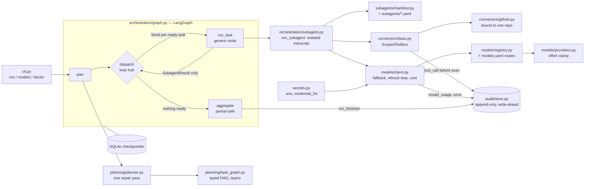

# Conductor (`strata_dev`): case-study dossier

> Source: `github.com/rohan2010/strata_dev` (public), read at HEAD `b141e64`. The package is `conductor`. The repo's own README says it is a **Phase 0 spike**, verified by tests against *scripted* models; no run has touched a real API or repository. The page must keep that framing.

## 1. Hook

**Hook:** Describe a goal, and Conductor plans the work, delegates it to isolated specialist agents on whichever model suits each job, and hands you a pull request to review.

- **Problem:** Single-agent loops fill their context with every file and tool result, and quality degrades exactly when the task gets big. Safety rules written only in prompts can be talked around.
- **For:** developers who want multi-agent automation with real boundaries: per-agent tool allow-lists, vendor-agnostic routing and an auditable trace. The PRD's eventual beachhead is the bridge between UX research and engineering.

## 2. Architecture

### Node list

| id | label | kind | file(s) |
|---|---|---|---|
| `cli` | CLI: `run`, `models`, `doctor` | entry | `src/conductor/cli.py` |
| `plan` | plan node | graph-node | `src/conductor/orchestration/graph.py` |
| `dispatch` | dispatch loop hub | graph-node | `graph.py` |
| `run_task` | generic run_task node | graph-node | `graph.py` |
| `aggregate` | aggregate (PARTIAL / FAILED roll-up) | graph-node | `graph.py` |
| `planner` | Planner (one repair pass) | core | `src/conductor/planning/planner.py` |
| `task_graph` | Typed task graph (validation, layers, ready, blocked_by) | data-model | `src/conductor/planning/task_graph.py` |
| `state` | RunState + SubagentResult (no transcript field) | data-model | `src/conductor/orchestration/state.py` |
| `subagent` | run_subagent (isolated conversation) | core | `src/conductor/orchestration/subagent.py` |
| `manifest` | Subagent manifests + registry | config | `src/conductor/subagents/manifest.py`, `subagents/implementer.yaml`, `subagents/reviewer.yaml` |
| `toolbox` | ScopedToolbox (allow-list enforcement) | security-boundary | `src/conductor/connectors/base.py` |
| `github` | GitHub connector (REST, single repo) | connector | `src/conductor/connectors/github.py` |
| `model_client` | Model client (fallback, refusal, cost) | core | `src/conductor/models/client.py` |
| `registry` | Route registry | config | `src/conductor/models/registry.py`, `models.yaml` |
| `providers` | Provider capability + effort translation | adapter | `src/conductor/models/providers.py` |
| `audit` | Audit event store (SQLite) | storage | `src/conductor/audit/store.py` |
| `checkpoint` | LangGraph SQLite checkpointer | storage | `graph.py` `sqlite_checkpointer` |
| `secrets` | .env loading, credential_for | config | `src/conductor/secrets.py` |
| `providers_ext` | Anthropic / OpenAI / Gemini / Ollama | external | via langchain-* integrations |

### Edge list

| from | to | label |
|---|---|---|
| `cli` | `plan` | goal + `--repo` |
| `plan` | `planner` | goal + roster from registry |
| `planner` | `task_graph` | validated DAG (repair once on failure) |
| `plan` | `dispatch` | — |
| `dispatch` | `run_task` | `Send` per ready task (one dependency layer per superstep) |
| `run_task` | `subagent` | TaskEnvelope + upstream summaries |
| `subagent` | `manifest` | resolve manifest at dispatch time |
| `subagent` | `toolbox` | tool calls (only allow-listed tools are bound) |
| `toolbox` | `github` | invoke after allow-list check |
| `toolbox` | `audit` | write-ahead `tool_call`, then `tool_result` |
| `subagent` | `model_client` | role → route |
| `model_client` | `registry` | ordered fallback chain |
| `model_client` | `providers` | effort clamped downward per provider |
| `model_client` | `providers_ext` | API call |
| `model_client` | `audit` | `model_usage`, per-attempt `error` |
| `run_task` | `dispatch` | SubagentResult (summary + artifacts only) |
| `dispatch` | `aggregate` | nothing ready |
| `aggregate` | `audit` | `run_finished` (status, cost, tokens) |
| `secrets` | `model_client` | credential per provider |

**Boundaries:** (1) orchestrator context vs. subagent transcript: `RunState` has nowhere to put a transcript; (2) subagent vs. tools: `ScopedToolbox` raises `PermissionError` before checking whether a tool exists; (3) subagent vs. repository: the GitHub connector is bound to one repo at construction; (4) callers vs. vendors: only `conductor/models/` imports provider integrations.

## 3. Key decisions and trade-offs

| Decision | Trade-off | Evidence |
|---|---|---|
| **Isolation enforced by type shape:** subagent messages are discarded on return | Orchestrator never sees raw tool output, so summaries must be good enough | commit `ddb7d89`; `orchestration/state.py`; README "The idea in thirty seconds" |
| **Dispatch as a loop hub, not a one-shot fan-out** | Runs one dependency layer per superstep: parallel where independent, and the checkpointer knows which layer was in flight | commit `ddb7d89`; `graph.py` |
| **One generic `run_task` node** instead of one node per subagent (departs from the original plan, and the plan was updated) | Adding a subagent is a YAML file, with no graph branch to extend | commit `ddb7d89`; README "Adding a subagent" |
| **Refusal abandons the fallback chain; transport errors fall through** | Rerouting a declined request vendor to vendor is a safety bypass; outages are not | commit `f2fdb0a`; `models/client.py` |
| **Effort as declared intent, clamped downward** | Never silently buys more reasoning than asked; `conductor models effort` shows declared vs. delivered | commit `f2fdb0a`, `6f8aff6`; `models/providers.py` |
| **Unpriced models report tokens with no dollars, plus an `unpriced_calls` count** | "A silent $0 is worse than an honest gap" | commit `f2fdb0a` |
| **Per-attempt audited fallback instead of `Runnable.with_fallbacks`** | More code, but every attempt is traceable | commit `f2fdb0a` |
| **Allow-list checked before existence** | Probing agents learn nothing about tools they can't use | commit `453b2cf`; `connectors/base.py` |
| **Remove the repo parameter rather than validate it** | Least privilege by construction | commit `453b2cf` |
| **Planner repairs once, then fails visibly** | Avoids burning budget hiding a misunderstood goal | commit `6d91062`; `planning/planner.py` |
| **Reviewer routed to a different vendor than the Implementer** | "Cheapest independence available" against shared blind spots | `models.yaml` comment; README |
| **Audit log lands before the first agent** | Append-only and write-ahead; a lock serializes seq numbers (Postgres sequence later) | commit `7b970bb`; `audit/store.py` |
| **Plan departs from PRD phasing in four places** (policy engine gets a full week, vector memory moves later, "study end-to-end" cut, manual baseline added to Phase 0) | Explicit scope management | `EXECUTION-PLAN.md` §7 |

## 4. Interesting engineering details

1. **Wire-name mapping for namespaced tools.** Tools are named `connector.tool`, but every provider validates names against `^[a-zA-Z0-9_-]{1,64}$`. `wire_name` swaps the dot for `__` on the wire and maps it back before dispatch, so the allow-list and audit log keep readable names. *Evidence: commit `453b2cf`; `connectors/base.py` `wire_name`, `resolve`.*
2. **Write-ahead audit semantics.** A `tool_call` with no `tool_result` is the readable signal that something died in flight. Thread-safe seq assignment works under a lock because read-MAX-then-insert races under parallel dispatch. *Evidence: commit `7b970bb`; `audit/store.py`.*
3. **Plan-time graph validation:** cycles, duplicate ids, self-dependencies and unknown dependencies fail at plan time instead of as a hang. Failures are contained: dependents are marked SKIPPED with their blocking cause, and the run degrades to PARTIAL. *Evidence: commits `6d91062`, `ddb7d89`; `task_graph.py` (`_structurally_sound`, `layers`, `blocked_by`).*
4. **Prompts tuned to model dispositions, with the reasoning recorded.** There's no "double-check your work" (it causes over-verification). The Reviewer asks for every finding with severity, because "only report high-severity" depresses recall. *Evidence: commit `b9f2796`; `subagents/*.yaml` comments.*
5. **`conductor doctor` moves minute-nine failures to second zero.** It cross-checks routes, tools, capability matches (tool-using agents only on tool-capable models) and credentials, but only for reachable providers. *Evidence: commit `6f8aff6`, `b20b706`; README.*

## 5. What I learned (drafts)

- *DRAFT – confirm with Rohan:* "A boundary that's a sentence in a prompt isn't a boundary. I moved every rule I cared about into code: the type shape, the allow-list, the constructor signature." (commits `453b2cf`, `ddb7d89`)
- *DRAFT – confirm with Rohan:* "Being honest about state is part of the design. The README has a known-gaps table and says no live run has happened yet." (commit `b141e64`; README "Known gaps")
- *DRAFT – confirm with Rohan:* "Fallback and safety pull against each other. Treating a refusal like an outage would turn resilience into a jailbreak." (commit `f2fdb0a`)
- *DRAFT – confirm with Rohan:* "Measure the manual baseline before automating, because you can't recover it afterwards." (`EXECUTION-PLAN.md` §7 item 4)

## 6. Status, timeline, stack, links

- **Status:** Phase 0 spike. The full path is exercised end to end against scripted models. The README badge says 104 tests passing (93 `def test_` functions; parametrization likely accounts for the rest). No live provider or repo run yet. Next: verify non-Anthropic model ids, record the manual baseline, CI and Postgres, the policy engine, structured memory.
- **Timeline:** repo created 2026-07-21; PRD dated 20 Jul 2026. First commit `da6b3c3` and last commit `b141e64` both on 2026-07-27 (14:41 → 14:59 +0530, 10 commits; the work was likely staged and committed in one sitting).
- **Stack:** Python 3.11, LangGraph (+ SQLite checkpointer), Pydantic v2, Typer, Rich, httpx, LangChain integrations for Anthropic, OpenAI, Google GenAI and Ollama, python-dotenv, pytest, ruff, uv/hatchling. The README hero is a hand-written SMIL-animated SVG (`docs/assets/hero.svg`).
- **Links:** repo https://github.com/rohan2010/strata_dev. No demo.

## 7. Visual idea

**An animated run trace:** a goal enters, the planner draws a DAG, and the dispatch hub fires one *layer* at a time (parallel packets fork, then wait). Each subagent box shows its own sealed transcript that is visibly *discarded*; only a small summary card travels back. A side rail streams audit events (`tool_call` → `tool_result`), and a blocked tool call flashes a red `PermissionError` that returns to the model. A toggle swaps the Reviewer's vendor to show routing is config-only. The README hero (`docs/assets/hero.svg`) already sketches the packet animation.

## 8. Open questions for Rohan

1. Name for the page: "Conductor" or "strata_dev"? Is "strata" a planned product name?
2. The PRD lists "Owner: [You]" with "Eng, Design/Research" contributors. Is this solo work, or part of a team or startup? Who should be credited?
3. Has any live run happened since July 2026? If so, is there a real PR or trace we could show (redacted)?
4. Are the PRD and execution plan OK to link publicly? They're already in the public repo.
5. Do you want to connect this explicitly to BulkMagic's LangGraph work, or keep personal and professional separate?
