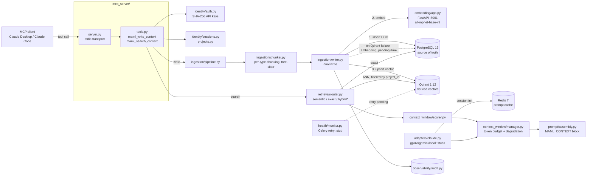

# DecentralMem.AI / MAML (`decenz-mcp` + private `decentmemAI`): case-study dossier

> **Sources.**
> - **Public:** `github.com/rohan2010/decenz-mcp`, read at HEAD `8282dc4`. The code lives under `maml/`. Everything not tagged comes from here and is safe to publish.
> - **Private:** `github.com/rohan2010/decentmemAI` (private), read at HEAD `ecc6ccf`. It holds a concept `readme.md` and a folder of research-paper PDFs, and **no code**. Everything learned only from it is tagged **`PRIVATE-SOURCE`** and needs Rohan's approval before publication. No code or secrets from it are quoted here (it has none).
> - **Résumé:** `docs/RP_resume_developer.pdf`, "DecentralMem.AI — Model-Agnostic Persistent Memory Layer".
>
> **Résumé vs. code (check before publishing).** The résumé says MAML serves memory "to Claude, GPT-4o, Gemini, and local LLMs". In the public code only the **Claude adapter** is implemented; `adapters/gpt4o.py`, `gemini.py` and `local.py` raise `NotImplementedError` (README roadmap: "Phase 3"). The résumé's "retry logic on vector-store failure" exists as an `embedding_pending` flag set on Qdrant failure (`ingestion/writer.py`), but the background retry worker is a Phase 3 stub (`health/monitor.py`). Note too that the MCP interface is model-agnostic by nature, so any MCP-capable client can call the tools.

## 1. Hook

**Hook:** One project memory that survives new sessions and model switches. Decisions, constraints and architecture notes written once, through an MCP server, come back automatically for whichever model you use next.

- **Problem:** Every new chat or model starts from zero, so people re-explain their project, and teams on different LLMs can't build on each other's context. `PRIVATE-SOURCE`: the concept readme frames it as teammates on ChatGPT and Gemini needing "a common data layer that is transferable and readable across different LLMs, without consuming the entire context window each time."
- **For:** developers and small teams using several AI assistants on the same project.

## 2. Architecture

### Node list

| id | label | kind | file(s) | state |
|---|---|---|---|---|
| `client` | MCP client (Claude Desktop / Claude Code) | external | `maml/docs/CLAUDE_DESKTOP_SETUP.md` | — |
| `mcp_server` | MCP server (stdio) | entry | `maml/mcp_server/server.py` | done |
| `tools` | `maml_write_context`, `maml_search_context` | api | `maml/mcp_server/tools.py` | done |
| `auth` | API-key auth (`maml_` prefix, SHA-256 hashed) | security | `maml/identity/auth.py` | done |
| `sessions` | Projects + sessions (auto-create/reuse) | core | `maml/identity/sessions.py`, `projects.py` | done |
| `pipeline` | Ingestion pipeline | core | `maml/ingestion/pipeline.py` | done |
| `chunker` | Type-aware chunker | core | `maml/ingestion/chunker.py` | done |
| `writer` | Dual writer (PG first, then Qdrant) | core | `maml/ingestion/writer.py` | done |
| `embedding` | Embedding service (FastAPI, all-mpnet-base-v2) | service | `maml/embedding/app.py`, `model.py`, `Dockerfile.embedding` | done |
| `postgres` | PostgreSQL (source of truth) | storage | `maml/storage/postgres.py`, `infra/migrations/versions/0001_initial_schema.py` | done |
| `qdrant` | Qdrant (vectors, project-scoped) | storage | `maml/storage/qdrant.py` | done |
| `redis` | Redis (session prompt cache, 4 h TTL) | storage | `maml/storage/redis.py` | done |
| `router` | Retrieval router | core | `maml/retrieval/router.py`, `semantic.py`, `exact.py`, `hybrid.py` | hybrid = stub |
| `scorer` | Relevance scorer | core | `maml/context_window/scorer.py` | done |
| `cwm` | Context Window Manager | core | `maml/context_window/manager.py` | done |
| `assembly` | Prompt assembly | core | `maml/prompt/assembly.py` | done |
| `adapters` | Model adapters | adapter | `maml/adapters/*.py` | Claude done; others stub |
| `audit` | Audit log | observability | `maml/observability/audit.py` | done |
| `health` | Celery health/retry tasks | background | `maml/health/monitor.py` | stub |
| `visualizer` | DB visualizer dashboard (:8080) | tooling | `maml/tools/db_visualizer.py` | done |
| `schema` | CCO (Context Carry-Over) schema | data-model | `maml/core/schema.py` | done |

### Edge list

| from | to | label |
|---|---|---|
| `client` | `mcp_server` | MCP tool call (stdio) |
| `mcp_server` | `tools` | dispatch |
| `tools` | `auth` | verify API key before storage |
| `tools` | `sessions` | resolve project, reuse or create session |
| `tools` | `pipeline` | write: CCO in |
| `pipeline` | `chunker` | split by `context_type` |
| `chunker` | `writer` | chunks |
| `writer` | `postgres` | 1. insert CCO (must succeed) |
| `writer` | `embedding` | 2. `POST /embed` |
| `writer` | `qdrant` | 3. upsert vector + payload (`project_id` mandatory) |
| `writer` | `postgres` | on Qdrant failure: `embedding_pending = true` |
| `writer` | `audit` | audit entry |
| `tools` | `router` | search: query + filters |
| `router` | `qdrant` | ANN filtered by `project_id`, `is_archived=false` |
| `router` | `postgres` | exact / filtered query |
| `router` | `scorer` | ScoredCCOs |
| `scorer` | `cwm` | ranked CCOs |
| `cwm` | `assembly` | CCOs within budget + `degradation_level` |
| `adapters` | `redis` | cached session system prompt |
| `health` | `qdrant` | retry pending embeddings (planned) |

**Boundaries:** (1) model vs. memory: only MCP tools cross it; (2) source of truth vs. derived index: PostgreSQL vs. Qdrant; (3) tenant namespaces: every query is scoped by `project_id` ("There is no code path that bypasses namespace isolation", `maml/README.md`); (4) the self-hosted embedding service, with no external embedding APIs.

## 3. Key decisions and trade-offs

| Decision | Trade-off | Evidence |
|---|---|---|
| **PostgreSQL is truth, Qdrant is derived;** never raise on Qdrant failure | Writes always land; search may briefly miss items until re-embedded | `maml/ingestion/writer.py` docstring; `maml/README.md` "Key design principles" |
| **Self-hosted embeddings only** (`sentence-transformers/all-mpnet-base-v2`) | No data leaves for embedding; costs a 60 s model load and a service to run | `maml/README.md`; `maml/embedding/model.py` |
| **Mandatory `project_id` filter** on every vector search | Strong isolation; callers must always carry project scope | `maml/storage/qdrant.py` ("ALWAYS filtered by project_id") |
| **Typed memory (CCO) with 9 context types**, and chunking only for long types | Constraints and decisions stay atomic; code is split at function/class boundaries | `maml/core/schema.py`; `maml/ingestion/chunker.py` |
| **Per-model token budgets** (Claude 40% of 200K, GPT-4o 35% of 128K, local 25% of 8K) | Memory never crowds out the conversation; small models get less | `maml/context_window/manager.py` docstring |
| **Explicit degradation levels** returned to the caller (`full` → `summarised` → `type_filtered` → `recency_filtered`) | The caller knows when context was cut | `manager.py`; `maml/README.md` search response |
| **API keys stored as SHA-256 hashes, shown once** | Standard practice; a lost key can't be recovered | `maml/identity/auth.py` |
| **MCP stdio as the integration surface** | Works with any MCP client without per-model SDK code | `maml/mcp_server/server.py` |
| `PRIVATE-SOURCE` **Early ideas not carried into code:** TOON format for compression, knowledge graphs, AWS hosting | The shipped design chose Postgres + Qdrant + Redis instead (motivation unknown) | private `readme.md` "Tech Stack" |

## 4. Interesting engineering details

1. **A cross-session acceptance test as the "moat" check.** Session A writes a JWT constraint and ends. A fresh Session B asks "What authentication approach have we decided on?", and the test asserts the constraint is the top result. *Evidence: `maml/tests/test_phase2_loop.py::test_cross_session_context_loop`, `maml/README.md`.*
2. **A transparent relevance formula:** 0.5·similarity + 0.2·recency (1/(1+days)) + 0.2·type priority (constraints and architecture 1.0 … external docs 0.3) + 0.1·access frequency. *Evidence: `maml/context_window/scorer.py`.*
3. **A drop order under budget pressure:** external docs first, then conversation, file refs, tasks, code and preferences. Constraints, architecture and decisions are never type-dropped. *Evidence: `maml/context_window/manager.py` `_DROPPABLE_TYPES_ORDER`.*
4. **Tree-sitter code chunking with a fallback** to a recursive splitter on `class`/`def` separators if parsing fails. *Evidence: `maml/ingestion/chunker.py`.*
5. **The embedding service validates itself on load:** double-checked locking loads the model once and asserts the vector dimension before serving. *Evidence: `maml/embedding/model.py`.* Also a full-stack DB visualizer for Postgres, Qdrant and Redis (`maml/tools/db_visualizer.py`, 819 lines), and Docker Compose for the dev and test stacks (`maml/infra/`).

## 5. What I learned (drafts)

- *DRAFT – confirm with Rohan:* "Pick one source of truth and let everything else be rebuildable. That decision made vector-store outages a delay rather than data loss." (`ingestion/writer.py`)
- *DRAFT – confirm with Rohan:* "Not all memory is equal. A constraint should never be dropped to make room for chat history, so I made the priority explicit in the scorer and the degradation order." (`scorer.py`, `manager.py`)
- *DRAFT – confirm with Rohan:* "Write the test that proves the product's promise first. Phase 2 was 'done' when one cross-session test passed." (`test_phase2_loop.py`)
- *DRAFT – confirm with Rohan*, `PRIVATE-SOURCE`: "I started by reading research on agent memory before writing code." (private repo: commits "research to be considered", "Added more research papers", a "Definite reads" folder of arXiv PDFs.)

## 6. Status, timeline, stack, links

- **Status:** Phase 2 complete per README: MCP write + search, Claude adapter, cross-session test. Phase 3 (GPT-4o, Gemini and local adapters, Celery retry), Phase 4 (BM25 hybrid via RRF, LLM context-type detection, contradiction detection) and Phase 5 (web UI) are roadmap. 50 test functions across 7 test files (need live Docker services).
- **Timeline:**
  - `PRIVATE-SOURCE` concept repo `decentmemAI`: created 2026-02-21; first commit `7c04409` on 2026-02-21, last commit `ecc6ccf` on 2026-02-23 (6 commits: readme + papers).
  - Public `decenz-mcp`: created 2026-03-13; first commit `c74cb87` on 2026-03-13 ("new setup - claude"), last commit `8282dc4` on 2026-03-14 ("First version with write and search function and db visualizer"). 3 commits.
- **Stack:** Python 3.11, MCP Python SDK (stdio), FastAPI + uvicorn, SQLAlchemy async + asyncpg, Alembic, PostgreSQL 16, Qdrant 1.12, Redis 7 (AOF, LRU 512 MB), sentence-transformers (all-mpnet-base-v2), tiktoken (cl100k_base), LangChain text splitters, tree-sitter, structlog, Celery (stub), Docker / Colima, pytest.
- **Links:** repo https://github.com/rohan2010/decenz-mcp. No demo. The private repo must not be linked.

## 7. Visual idea

**"Same memory, different model" swap.** A project memory panel (typed cards: constraint, decision, architecture…) sits in the middle. On the left, a chat session with model A writes a constraint and ends. On the right, a fresh session with model B asks a question, and the constraint lights up as the top result, with its score broken into the four weighted bars. A budget slider shrinks the context window and shows types dropping in the real degradation order, with the `degradation_level` label changing. This is also the landing page's "bench" thesis (the memory stays, the model swaps), so the two can share visual language.

## 8. Open questions for Rohan

1. **Approve the `PRIVATE-SOURCE` items** (concept-readme framing and quote, TOON / knowledge-graph / AWS ideas, the research-reading phase, February 2026 dates). Can any be published?
2. **Team or solo?** `PRIVATE-SOURCE`: the concept readme says "my teammate Rohan uses Gemini", which reads as written by someone else. GitHub's collaborator list (owner-only metadata) shows `grazinga-grazille` and `commitChomks` on `decentmemAI`, and `commitChomks` on `decenz-mcp`. Who are they, and how should they be credited?
3. **Résumé accuracy:** only the Claude adapter exists in public code, and the retry worker is a stub. Is there newer, unpushed code? If not, should the page say "MCP-compatible; Claude adapter shipped, others planned"?
4. Naming: "DecentralMem.AI" (résumé), "Decent AI" (`PRIVATE-SOURCE` readme), "MAML" (code), "decenz-mcp" (repo). Which is canonical for the page, and what year should it show (2026)?
5. Is `decenz-mcp` meant to stay public? `maml/.env.example` holds only local dev defaults (not quoted here), but confirm nothing sensitive is in history.
