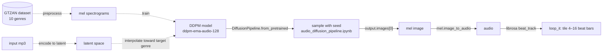

# NoteNinja: case-study dossier

> Source: `github.com/rohan2010/NoteNinja` (public), read at HEAD `6271927`. **Thin evidence.** The repo holds a README and one 12-cell notebook. Rohan made only the repo's initial commit (`422aa51`). The README and the notebook were committed by **Anav-117** (4 of 5 commits). The notebook is adapted from `teticio/audio-diffusion` (its first cell links to that Colab) and only does unconditional generation; **no genre-interpolation code is in the repo.** Present this as a team course or research project, and confirm Rohan's role before publishing.

## 1. Hook

**Hook:** Turn a pop song into jazz while keeping the tune, by moving through a diffusion model's latent space of mel spectrograms.

- **Problem (README):** you like a song's melody but wish it were in another genre.
- **For (README):** music producers (idea generation), music educators (theory and composition) and music therapists (personalised music).

## 2. Architecture

As *described in the README* (dashed) and as *implemented in the notebook* (solid).

### Node list

| id | label | kind | evidence |
|---|---|---|---|
| `gtzan` | GTZAN dataset (10 genres) | dataset | README "Process" (described only) |
| `spec` | Mel-spectrogram preprocessing | data-prep | README (described only) |
| `ddpm` | DDPM audio diffusion model (`ddpm-ema-audio-128`, local path) | model | notebook `model_id = "../../models/ddpm-ema-audio-128"` |
| `gen` | Seeded generation via `DiffusionPipeline` | inference | `audio_diffusion_pipeline.ipynb` |
| `img` | Generated mel image | artefact | notebook |
| `audio` | Audio via `mel.image_to_audio` | artefact | notebook |
| `loop` | Beat-aligned looping (`loop_it`) | post-process | notebook |
| `input` | User's source mp3 | input | README (described only) |
| `latent` | Latent-space genre interpolation | core-idea | README (described only, not in code) |

### Edge list

| from | to | label | implemented? |
|---|---|---|---|
| `gtzan` | `spec` | convert audio → spectrograms | no (described) |
| `spec` | `ddpm` | train | no (described) |
| `ddpm` | `gen` | load pipeline | yes |
| `gen` | `img` | `output.images[0]` | yes |
| `img` | `audio` | `mel.image_to_audio` | yes |
| `audio` | `loop` | `beat_track`, tile bars | yes |
| `input` | `latent` | encode | no (described) |
| `latent` | `ddpm` | interpolate → decode to target genre | no (described) |

## 3. Key decisions and trade-offs

| Decision | Trade-off | Evidence |
|---|---|---|
| Work in **mel-spectrogram image space** with an image diffusion model | Reuses image-diffusion tooling; the cost is lossy audio reconstruction ("fuzzy spectrograms" → noisy audio) | README "Process", "Challenges" |
| **Build on teticio/audio-diffusion** instead of from scratch | Fast start; the notebook is largely the upstream one with a local model path | notebook cell 1 (Colab link), `model_id` cell |
| **GTZAN** as the training set (10 labelled genres) | Clean genre labels; GTZAN is small (30 s clips) | README "Process" |
| 128-px model (`ddpm-ema-audio-128`) vs. upstream 256 | Cheaper training and sampling; lower fidelity (inference: consistent with the "fuzzy spectrograms" challenge) | notebook `model_id` |

## 4. Interesting engineering details

Only modest details are evidenced:

1. **Beat-aware looping:** `loop_it` uses `librosa.beat.beat_track` and tries 16, 12, 8, then 4 beats-per-bar to cut a loopable segment and tile it. *Evidence: notebook.* (This function comes from the upstream notebook; confirm.)
2. **Seed logging for reproducible samples:** each generation prints and re-applies its seed. *Evidence: notebook.*
3. **Diagnosis in the README:** the team traced noisy audio to blurry spectrograms and prioritised spectrogram sharpness. *Evidence: README "Challenges".*

There isn't enough evidence for 3–5 strong senior-level details.

## 5. What I learned (drafts)

- *DRAFT – confirm with Rohan:* "Audio quality in spectrogram diffusion is limited by the spectrogram. Blurry images become noisy audio, so fidelity work has to start there." (README "Challenges")
- *DRAFT – confirm with Rohan:* (only if true) what Rohan personally owned on the team. No commit evidence of his code exists.

## 6. Status, timeline, stack, links

- **Status:** inactive since 2023-12-19. Exploratory; the genre-interpolation tool isn't in the repo.
- **Timeline:** repo created 2023-10-18. First commit `422aa51` (rohan2010, 2023-10-18); last commit `6271927` (Anav-117, 2023-12-19, "diffusion model generation pipeline"). 5 commits.
- **Stack:** Python, Jupyter/Colab (GPU), PyTorch, Hugging Face `diffusers` (`DiffusionPipeline`, DDPM), librosa, datasets, OpenCV, PIL.
- **Links:** repo https://github.com/rohan2010/NoteNinja. No demo. Upstream: https://github.com/teticio/audio-diffusion.
- **Context (inference):** dates fall in Rohan's Purdue M.S. (Aug 2022 – May 2024), so it was likely a course project. Confirm.

## 7. Visual idea

**A spectrogram strip morphing between genres.** A mel spectrogram slides from "pop" to "jazz" along a slider, with audio playback at each end. **Only use real outputs**; if no generated samples survive, use a static diagram of the *intended* pipeline, labelled "concept".

## 8. Open questions for Rohan

1. What was your role? Anav-117 committed the README and notebook. Who else was on the team, and was this a Purdue course (which one)?
2. Did latent-space genre interpolation ever work, or only unconditional generation? Is the trained `ddpm-ema-audio-128` model or any audio samples still around?
3. Do you want this on the site at all? It's 2023 work with thin code; it may fit better as a one-line entry in an "earlier work" list.
