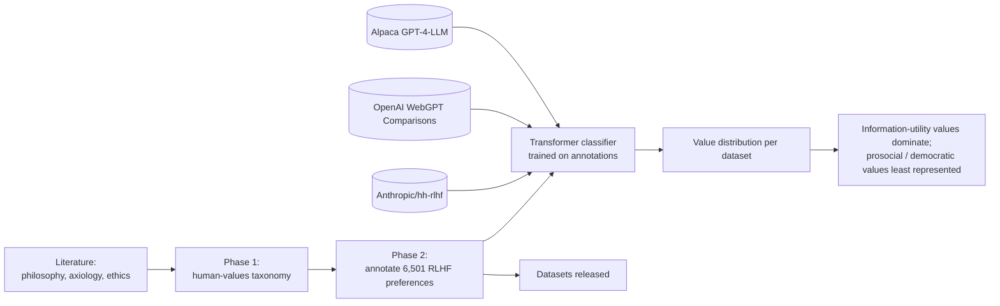

# Value Imprint (NeurIPS 2024): case-study dossier

> **Sources (only these two):** (1) the résumé, `docs/RP_resume_developer.pdf`, "Projects & Publications"; (2) the paper's public abstract and listing pages, found by web search on 2026-10-22. No code repo was read. The paper's dataset repo is linked from the listing, `github.com/hv-rsrch/valueimprint`; it was not read and isn't Rohan's account. **Everything below about the architecture describes the method at abstract level only.**

## Venue: needs confirming

- **Title:** *Value Imprint: A Technique for Auditing the Human Values Embedded in RLHF Datasets*
- **Authors (per the proceedings page):** Ike Obi, **Rohan Pant**, Srishti Shekhar Agrawal, Maham Ghazanfar, Aaron Basiletti (Purdue University). Rohan is **second author**.
- **Venue and track (per the proceedings page):** NeurIPS 2024, **Datasets and Benchmarks Track** (Advances in Neural Information Processing Systems 37). DOI `10.52202/079017-3628`.
- **Presentation (per the NeurIPS virtual site):** listed as a **"Spotlight Poster"**, poster ID 97583.
- **URLs:**
  - Proceedings abstract: https://proceedings.neurips.cc/paper_files/paper/2024/hash/cf7ec6aa55ba2b2f7af0cf3fd25b7f8c-Abstract.html
  - NeurIPS virtual poster: https://neurips.cc/virtual/2024/poster/97583
  - arXiv: https://arxiv.org/abs/2411.11937
  - Slides: https://neurips.cc/media/neurips-2024/Slides/97583.pdf
  - Datasets and code (per the abstract): https://github.com/hv-rsrch/valueimprint
- **⚠ Rohan to confirm:** the track (D&B, not main conference), "Spotlight", the author order, and which link the site should use. The landing-page plan currently says "published at NeurIPS 2024" with no track. Say "NeurIPS 2024 (Datasets & Benchmarks track)" unless Rohan prefers otherwise.

## 1. Hook

**Hook:** Before an AI model is aligned with "human preferences", whose values are actually in that data? Value Imprint audits RLHF datasets for the human values they encode.

- **Problem:** RLHF datasets steer LLM behaviour, but the human values embedded in them were not systematically audited.
- **For:** alignment researchers, dataset builders and anyone choosing preference data to train on.

## 2. Architecture (method level, from the abstract and résumé)

### Node list

| id | label | kind | source |
|---|---|---|---|
| `literature` | Prior work in philosophy, axiology, ethics | input | abstract |
| `taxonomy` | Human-values taxonomy (phase 1) | method | abstract; résumé "ethics-based taxonomy" |
| `annotation` | 6,501 annotated RLHF preferences (phase 2) | dataset | abstract; résumé |
| `classifier` | Transformer-based classifier | model | abstract; résumé |
| `hh_rlhf` | Anthropic/hh-rlhf | external-dataset | abstract; résumé |
| `webgpt` | OpenAI WebGPT Comparisons | external-dataset | abstract; résumé |
| `alpaca` | Alpaca GPT-4-LLM | external-dataset | abstract; résumé |
| `audit` | Per-dataset value distribution | output | abstract |
| `finding` | Dominant vs. under-represented values | result | abstract |
| `release` | Open-sourced datasets | artefact | abstract; résumé "datasets open-sourced" |

### Edge list

| from | to | label |
|---|---|---|
| `literature` | `taxonomy` | derive categories |
| `taxonomy` | `annotation` | label preferences |
| `annotation` | `classifier` | train |
| `hh_rlhf` / `webgpt` / `alpaca` | `classifier` | classify |
| `classifier` | `audit` | value labels |
| `audit` | `finding` | compare distributions |
| `annotation` | `release` | open-source |

## 3. Key decisions and trade-offs (abstract level only)

| Decision | Evidence |
|---|---|
| Ground the taxonomy in philosophy, axiology and ethics rather than ad-hoc labels | abstract |
| Two phases: build the taxonomy, then annotate | abstract; résumé "two-phase NLP pipeline" |
| Scale the audit with a trained classifier instead of annotating everything by hand | abstract; résumé |
| Audit three widely used industry datasets | abstract; résumé |
| Release the datasets | abstract; résumé |

Implementation trade-offs (model choice, label scheme, agreement) are **not known** from these sources.

## 4. Interesting details

1. **Finding (published):** information-utility values (e.g. Wisdom/Knowledge, Information Seeking) were most dominant across all three datasets; prosocial and democratic values (e.g. Well-being, Justice, Human/Animal Rights) were least represented. *Source: abstract.*
2. **Scale:** 6,501 annotated preferences. *Source: abstract; résumé.* (A search summary attributed a "100K+ preferences" automated audit to the slides. **Unverified; don't use unless Rohan confirms.**)
3. **Through-line:** Rohan's later `bharat-edge` protocol plans to reuse the Value Imprint classifier to measure "value drift" under quantization (`bharat-edge` README H3, `src/bee/values.py`). That project is not published, so word any mention as "planned".

Fewer than 3–5 engineering details are possible without the code.

## 5. What I learned (drafts)

- *DRAFT – confirm with Rohan:* "Alignment data carries values whether or not anyone chose them. Measuring what's there is the first step to choosing deliberately." (abstract finding)
- *DRAFT – confirm with Rohan:* Rohan's specific contribution (e.g. pipeline, classifier training, annotation tooling). The résumé says "Built a two-phase NLP pipeline" and "Trained a transformer classifier", but as second author on a five-person paper this needs his own wording.

## 6. Status, timeline, stack, links

- **Status:** published, NeurIPS 2024 (Datasets & Benchmarks track, Spotlight Poster). Track and Spotlight **to confirm**.
- **Timeline:** during the Purdue M.S. HCI (Aug 2022 – May 2024, per résumé). arXiv `2411.11937` (Nov 2024). Exact project dates unknown.
- **Stack (résumé):** Python, Transformers, NLP.
- **Links:** see "Venue" above.

## 7. Visual idea

**A diverging bar chart of value categories across the three datasets**, information-utility values on one side and prosocial or democratic values on the other, so the imbalance reads at a glance. **Use the paper's own figure or numbers only** (with citation), never re-estimated values. Fallback: a two-phase method diagram (taxonomy → annotation → classifier → audit).

## 8. Open questions for Rohan

1. Confirm the venue wording: "NeurIPS 2024 Datasets & Benchmarks track, Spotlight"?
2. What exactly did you do on the paper? The page should describe your part and credit Ike Obi (first author) and co-authors.
3. Can we reproduce a figure from the paper (licence and permission), or should we link it instead?
4. Is the "100K+ preferences" automated-audit figure from the slides accurate?
5. Is `hv-rsrch/valueimprint` the canonical repo link?
